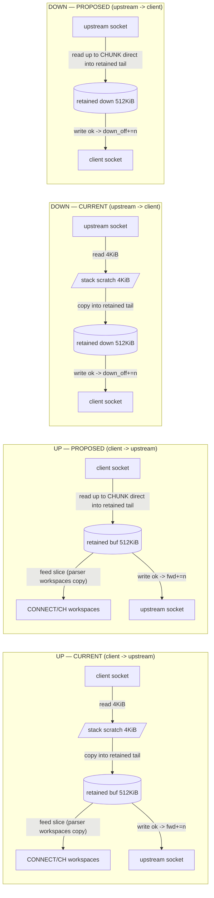

# Alumina — Reduced-Copy Single-Owner Relay Plan (Proposed)

> **STATUS: PROPOSED DESIGN — NOT IMPLEMENTED.** This is a document-only plan.
> It changes no runtime code, no dependency, and no line of the canonical
> specification `alumina.md` (sha256 `322b68ee…5b836`, byte-unchanged at HEAD
> `aa92329`). Every proposed edit listed here is a *seam-level proposal* cited
> against the current checkout at `aa92329`; none has been applied, and no
> implementation or benchmark execution is claimed. Diagrams labelled
> **PROPOSED** describe the target design, not the running system.
>
> The `showme` skill was requested for the visual but is **not available in the
> active skill list** of the producing session (a disk-directory
> `~/.config/opencode/skills/show-me/` is present, but the active skill registry
> exposes no loadable `showme`/`show-me` entry), so no `showme` invocation is
> claimed; the on-disk guidance was read directly. The companion visual
> `.ooda/show-me-reduced-copy-relay.html` (ignored, local-only) follows that
> guidance and agrees with this plan. No graph exists in the repository
> (`graphify-out` absent) and none was generated; all statements are grounded in
> direct local source reads at HEAD `aa92329`.

## 1. Objective, alignment, scope

**Objective (one line).** Remove the per-direction *retained-buffer* copy in the
single-owner relay by reading socket bytes directly into the already-initialized
unused tail of the existing retained per-direction buffer — and committing only
the returned **read** count — while leaving every fixed limit, cursor, gate
accounting rule, and outcome unchanged.

**Alignment with what already exists.** Bimodality and typed teardown are
**already-realised, as-built** design, not something this plan creates. The
Stage-gated relay pipeline at HEAD `aa92329` (canonical `alumina.md:34,50,147,
219,220`):

- **Typed setup (validated metadata, original bytes preserved).** CONNECT is
  incrementally parsed into `ConnectRequest{normalized FixedHostname}`
  (`src/connect.rs:121,133`); the initial ClientHello is inspected into
  `ValidatedHello` (`src/client_hello.rs:232-243`, `src/gate.rs:120`). Both run
  **only** in their pre-gate stages (`Stage::ReadingConnect` /
  `Stage::ValidatingHello`, `src/serving.rs:1335-1349,1383-1389`). Reads land in
  the retained buffer via `append_client_bytes` (`src/serving.rs:1405-1413`);
  parsers copy into their own fixed workspaces, leaving the retained stream
  untouched and forwardable (`src/connect.rs:133-139`; `src/client_hello.rs:232
  -243,304`).
- **Opaque relay (zero parser work).** `Stage::Relay` arms call only
  `append_client_bytes` + `flush_client_upstream`, and for the reverse flow raw
  `down` copy + `flush_down` (`src/serving.rs:1335-1389,1710-1744,1791-1868`).
  No parser/inspector is invoked post-gate; the proxy never decrypts payload or
  inspects TLS records (`alumina.md:50,219`).
- **Typed transport teardown (no encrypted-TLS inspection).** `classify_read`
  maps `Ok(0)`→`Activity::Eof`, `ConnectionReset`→`Reset`, `WouldBlock`→`Wait`,
  `Interrupted`→`Retry`, other→`Failed` (`src/serving.rs:222-233`). First EOF
  starts a never-reset 5 s drain deadline (`:1947-1978`, `DRAIN_SECS :82`);
  `finish_drain` half-closes a direction's write side only when that direction's
  accepted bytes have fully drained (`:1985-2009`); `maybe_close_drained` closes
  exactly once at both-EOF-drained (`:2013-2046`).

The plan's scope is therefore the **narrower retained-store copy removal**,
orthogonal to the parser workspaces: it does *not* create bimodality, enable
opaque forwarding, or touch typed teardown.

**Scope.** The two read sites in `src/serving.rs` that currently read into a
stack `scratch` and then copy into the retained buffer:

- client → upstream (`client_readable`): read at `src/serving.rs:1363-1376` →
  the `append_client_bytes` copy at `src/serving.rs:1405-1413`.
- upstream → client (`relay_upstream_to_client`): read at `src/serving.rs:1846
  -1854` → the `down` copy at `src/serving.rs:1861-1865`.

**Out of scope (unchanged behaviour / preserved exclusions).**

- Ring buffers, kernel zero-copy (`splice`/`sendfile`/`io_uring`/`MSG_ZEROCOPY`),
  multi-worker, new libraries, features, or `unsafe` uninitialized I/O.
- The parser-owned fixed-array copies that remain (see §5): direct-tail reads
  remove the scratch → retained copy **only**; the pipeline is not copy-free.
- Fixed resource profile: 128 slots × 2 × 512 KiB retained buffers = 128 MiB
  traffic storage (`src/inventory.rs:9-12`; `alumina.md:183`), ≤ 64 KiB or 16
  I/O ops per read loop per direction (`src/serving.rs:96-100`; `alumina.md:146`),
  zero post-boot heap alloc/dealloc incl. dependencies (`alumina.md:206`).
- Successful-write gate accounting (`committed = buf_base + fwd − head_len`,
  advance only on `Ok(n)`), coalesced tails, partial I/O, backpressure, fixed
  storage, single boot/serving owner: all preserved.
- Canonical spec, runtime code, dependencies, `docs/architecture.md` decisions,
  managed instructions and doctrine: none edited by this plan. No benchmark
  framework, numeric budget, daemon/VM/cloud effect, or runtime/E2E rerun for
  unchanged code.

No runtime/spec/dependency/managed-doctrine edits; no new enum/wrapper/injection
requirement; no force push or history rewrite.

## 2. Current state (as-built at HEAD aa92329)

Single-owner, single-threaded event loop (`src/serving.rs`; `alumina.md:
140,146,147`), per-slot `SlotWorkspace` (`src/serving.rs:312-340`). Each tunnel
slot owns two boot-retained 512 KiB buffers moved in by value from the boot
store (`src/serving.rs:343-373,494-500`):

| Buffer | Direction | Capacity | Cursor model |
|---|---|---|---|
| `buf` | client → upstream | `HOLD_CAP` 512 KiB (`:69`; `inventory.rs:11`) | `buf_base`, `buf_len`, `fwd`, `parse_rel`, `insp_rel`, `head_len`, `hello_end`, `hello_consumed` (`:323-331`) |
| `down` | upstream → client | `DOWN_CAP` 512 KiB (`:73`) | `down_len`, `down_off` only — no base, no compaction (`:332-334`) |

### 2.1 Copy inventory — client → upstream (per byte, current)

1. **Read** client socket into stack `scratch: [0u8; CHUNK]` (`src/serving.rs:
   1363-1376`; `CHUNK = 4096` `:100`, `MAX_OPS = 16` `:96`). Nonblocking;
   `WouldBlock` returns without progress; `Ok(0)` → `Activity::Eof`.
2. **Append copy** `append_client_bytes`: `copy_from_slice(&scratch[..n])` into
   the retained tail then `buf_len += n` (`src/serving.rs:1405-1413`). **This is
   the copy this plan removes.**
3. **Conditional compaction** `compact()`: `copy_within(fwd..buf_len, 0)` moving
   the live tail front, `buf_base` advanced in lockstep (`src/serving.rs:379
   -388`); runs only when `fwd > 0` (relay) and the tail is near cap
   (`buf_room`, `:1319-1325`).
4. **Parser/inspector internal copies (remain, out of scope):** CONNECT head
   copy (`src/connect.rs:133-139`); ClientHello input copy + flat-record copy
   (`src/client_hello.rs:232-243,304`); both fixed-array workspaces accounted in
   `SLOT_WORKSPACE_BYTES` (`src/inventory.rs:15-18`).
5. **Syscall write** upstream, `fwd += n` only on `Ok(n)` (`drain_to_upstream`
   `src/serving.rs:1710-1744`).

### 2.2 Copy inventory — upstream → client (per byte, current)

1. **Read** upstream socket into stack `scratch` (`src/serving.rs:1846-1854`),
   blocked at `down_len + CHUNK > DOWN_CAP` (`:1842`).
2. **Retained copy** `down[down_len..down_len+n].copy_from_slice(&scratch[..n])`
   then `down_len += n` (`src/serving.rs:1861-1865`). **This is the copy this
   plan removes.**
3. **Syscall write** client, `down_off += n` only on `Ok(n)` (`flush_down`
   `src/serving.rs:1791-1831`); full drain resets both cursors to 0
   (`:1826-1830`).

### 2.3 Gate and D3 write accounting (current)

Forwarded-byte accounting advances **only on successful writes**, cumulative and
non-decreasing (`src/gate.rs:208-240`). `committed = buf_base + fwd − head_len`
(`src/serving.rs:1758`). `drain_to_upstream` may issue several successful writes
in one burst; `flush_client_upstream` then reports the cumulative projection
ONCE per burst via `gate.upstream_write(committed)` (`:1746-1760`). D3 hence
locates the gate opening in this **worker accounting transition — before any
subsequent upstream read — not inside a single write syscall**
(`docs/architecture.md:75-79`; `alumina.md:147`). `upstream_write` returns
`GateOpened { crossing, relay_from_open }` where `relay_from_open =
cumulative − hello_len` counts the **accepted** trailing bytes only
(`src/gate.rs:228-235`). No second byte count exists.

**Immediate post-opening second drain.** On `GateOpened`/`Open`, after the gate
transition sets `Stage::Relay`, `flush_client_upstream` **immediately** calls
`drain_to_upstream` a second time and, if the second burst advanced `committed`,
issues a second `gate.upstream_write(committed2)` (`src/serving.rs:1773-1785`).
A residual coalesced tail therefore persists **only if the second drain also
stalls on a non-writable upstream**; otherwise it drains in the same call.

## 3. Concrete stream examples (source walk at aa92329, not executed)

### 3.1 Fragmented ClientHello + coalesced tail (+ immediate second drain)

CONNECT consumes `C` bytes; the valid initial ClientHello arrives as 1536 then
2560 wire bytes, coalesced with `X = 1000` trailing tunnel bytes. These are
stream offsets/read fragments, not preserved packets or TLS-record sizes.

1. Fragment 1 (1536) is incomplete → no forwarding (barrier A).
2. Fragment 2 (2560) completes validation at `hello_end = head_len +
   hello_consumed` → `H = 4096`; the 1000 coalesced bytes remain retained after
   `hello_end` (`src/serving.rs:1688-1694`).
3. **Burst 1 (WouldBlock-separated).** The upstream is not yet writable: a drain
   writes exactly 1536 accepted bytes then stalls (`WouldBlock`), so
   `drain_to_upstream` returns and `flush_client_upstream` reports the burst's
   ONE cumulative projection, 1536 — still below `H` → `WritingHello { total:
   4096 }` (`src/gate.rs:225-226`); `fwd` is set to `head_len − buf_base` on
   entry (`src/serving.rs:1693`).
4. **Burst 2 (separate, later upstream-writable edge).** A second drain writes
   a further 2964 bytes, cumulative 4500, crossing `H` by 404 → the single
   burst report is `GateOpened { crossing: 4500, relay_from_open: 404 }`
   (`src/gate.rs:228-235`). Because `gate.upstream_write` is invoked once per
   burst at the final cumulative (`:1747-1760`), a **single** burst with
   successive successful writes cannot surface an intermediate `WritingHello`
   at 1536 — that intermediate transition exists only across
   WouldBlock-separated bursts.
5. `flush_client_upstream` then immediately attempts a **second drain**
   (`src/serving.rs:1773-1785`). If it stalls, the 404 bytes already accepted by
   the crossing burst stay forwarded and residual `X = 596` remains retained-
   pending; if it does not stall, `X` drains in the same call. This plan
   retains, and the future TDD must test, the "immediate post-opening second
   drain" shape.
6. Residual `X` resumes on the upstream-writable relay arm (`src/serving.rs:1543
   -1552`) and on the client-readable relay re-flush before its next read
   (`:1356-1361`). `client_writable`'s relay arm flushes the down buffer and
   resumes upstream reads; it does **not** re-flush residual up `X`
   (`:1924-1938`).

### 3.2 FIN with reverse pending (directional drain, not TLS inspection)

Start Relay with upstream-pending bytes and downstream-pending bytes while the
downstream writes are stalled. Client FIN **arrival/readiness** merely makes the
`client_readable` arm eligible (`src/serving.rs:998-999`); pending **up** bytes
must flush first (`:1356-1360`), so an orderly EOF may not be **observed** until
those bytes drain. On a real `Ok(0)`: `classify_read` maps it to
`Activity::Eof` (`:222-233`) — a typed **TCP stream signal**, never a
close-notify or encrypted-record inspection (`alumina.md:219`).

- `observe_up_eof` sets up-side EOF and starts the once-only 5 s drain deadline
  if not already running (`src/serving.rs:1947-1958`).
- `finish_drain` half-closes the **upstream** write side only when the up buffer
  has fully drained (`fwd >= buf_len`); it neither discards the reverse
  (down-pending) bytes nor closes the client socket (`:1985-1995`).
- Down writes may later finish to the client, reset down cursors, and resume
  upstream reads (`:1791-1830,1924-1935`).
- When the upstream `Ok(0)` is then observed (`observe_down_eof` `:1965-1978`)
  and the down buffer drains, the client write side is half-closed; both
  half-closed states make `maybe_close_drained` close the slot exactly once
  (`:2013-2046`). Expiry with pending bytes is failure, not normal completion
  (`alumina.md:191,220`).

Distinguish TCP arrival/readiness from **observed** read EOF and from the
deadline start; `SideEof` carries the explicit state, and cursor checks
(`fwd >= buf_len`, `down_off >= down_len`) — not a new type — guarantee the
no-half-close-with-pending invariant (RF-003). Existing real-socket test
exercises client FIN then reverse drain (`src/serving.rs:3229-3339`; inspected,
not rerun here).

## 4. Proposed minimal change (PROPOSED — NOT IMPLEMENTED)

The seam is *reading directly into the initialized unused retained tail* and
committing only the returned count, dropping the stack `scratch` and its copy
into the retained buffer for both directions.

### 4.1 Up direction (client → upstream)

Replace `src/serving.rs:1363-1376` + `:1405-1413`:

1. The existing `buf_room` guard runs first (`:1319-1325,1348-1355`): it compacts
   when `fwd > 0 && HOLD_CAP − buf_len < CHUNK`, and refuses/rejects/returns when
   `buf_room < CHUNK`, so **no zero-length tail is ever handed to the nonblocking
   read** (a zero-length read returns `Ok(0)` = false `Eof`).
2. Read directly into a bounded tail slice
   `&mut ws.buf[buf_len .. buf_len + CHUNK]` (length `CHUNK`, sound because the
   guard guarantees ≥ `CHUNK` free). The `CHUNK` clamp preserves the 64 KiB /
   16-op-per-read-loop bound exactly (`:96-100`, `alumina.md:146`).
3. **Commit only the returned `n`** (a read count): `buf_len += n`.
   `WouldBlock` commits nothing.
4. Feed the parser/inspector from already-retained bytes
   `&ws.buf[parse_rel..buf_len]` / `&ws.buf[insp_rel..buf_len]` (the validate
   path already skips appending on an empty slice, `src/serving.rs:1649-1651`).
5. **Borrow ordering.** The tail borrow lives only across `read`; `buf_len` is
   mutated and compaction happens after the borrow ends (compact with a live
   tail slice is an aliasing defect). The up read is a **direct field-disjoint
   borrow** `(slot.client, &mut slot.buf[buf_len..])` in one scope (mirroring
   `drain_to_upstream` `:1714-1737`), **not** a call through the whole-owner
   `read_upstream(&mut self, …)` helper (`:1637`), whose `&mut self` overlaps a
   tail borrowed from the same `SlotWorkspace`. The borrow-clean shape is argued
   by construction here; compile/behavior proof remains producer-owned and
   planned (§7), never claimed as a review result.

**Removed copy:** §2.1 item 2. **Unchanged:** `fwd`/`compact()`/`buf_base`
invariant — compaction stays relay-only (pre-gate `fwd == 0` no-op,
`src/serving.rs:379-382`).

### 4.2 Down direction (upstream → client)

Replace `src/serving.rs:1846-1865`:

1. Keep the block-at-`down_len + CHUNK > DOWN_CAP` guard (`:1842`) — it is
   exactly the guarantee that the tail slice is non-empty; backpressure/refusal
   policy unchanged.
2. Read upstream directly into `&mut ws.down[down_len .. down_len + CHUNK]`.
3. Commit only the returned `n`: `down_len += n`; `WouldBlock` returns without
   mutation (`:1854` today).
4. `flush_down` (`:1791-1831`) and the full-drain reset (`:1826-1830`) are
   untouched; `down_off` advances only on successful client writes, refusal
   bodies flow through the same `down` store.

**Removed copy:** §2.2 item 2. **Unchanged:** the down cursor model, drain reset,
and FIN half-close (`finish_drain` `:1985-2009`, `maybe_close_drained`
`:2013-2046`).

### 4.3 Test seams (simplified; no forced helper)

`read_upstream(&mut self, index, buf)` (`src/serving.rs:1637`) borrows the whole
owner and cannot receive a mutable tail from `self.slots[index]`; the current
relay payload read already bypasses that helper (`:1846-1854`). Two facts:

- The relay payload read (down) is proposed as the **direct field-disjoint read**
  `(slot.upstream, &mut slot.down[down_len..])` — the same disjoint-field rule the
  file already relies on. That shape is argued by construction; compile proof is
  planned producer work.
- The **pre-open activity read** (`observe_upstream_read` `:1591-1635`) keeps a
  stack `scratch` and its `test_reads` hook (`:339,371,1639-1641`) stores only
  `io::Result<usize>` counts — payload is irrelevant because any observed
  activity terminates setup. That count-only semantics is preserved.

Real sockets are already the deterministic route the current relay tests use
(e.g. `relay_client_fin_drains_pending_bytes_then_half_closes_and_releases`
`src/serving.rs:3229`). An injected `Ok(n)` alone does not place bytes, so no
separate injection API is **mandatory** for the payload read; whether the TDD
cycle drives real sockets or adds a seam is a test-story decision consistent
with this plan's unchanged scope. The previous version overstated this need as a
required helper; this plan presents it as optional.

## 5. Diagrams (PROPOSED — NOT IMPLEMENTED)

### 5.1 Data path before/after, both directions



```text
CURRENT  client -> upstream : read->scratch  copy(scratch->buf)  feed(parse)  write(fwd)
PROPOSED client -> upstream : read -> buf tail (direct)         feed(parse)  write(fwd)
                              (scratch + scratch->buf copy removed)

CURRENT  upstream -> client : read->scratch  copy(scratch->down)  write(down_off)
PROPOSED upstream -> client : read -> down tail (direct)          write(down_off)
                              (scratch + scratch->down copy removed)

Workspace copies that REMAIN (not copy-free):
  CONNECT head copy (src/connect.rs:133-139)
  ClientHello input copy + flat-record copy (src/client_hello.rs:232-243,304)
  compaction copy_within (src/serving.rs:379-388)   [relay phase only]
```

### 5.2 Proposed cursor/held picture per direction

```text
UP    held       absolute [buf_base .. buf_base + buf_len)
      forwarded  absolute [buf_base .. buf_base + fwd)     (fwd = in-buffer offset)
      gate committed abs = buf_base + fwd - head_len
      PROPOSED tail read: &buf[buf_len .. buf_len+CHUNK], then buf_len += n

  buf_base            buf_base+fwd         buf_base+buf_len
  |-------------------|---------------------|----------------------|
  | forwarded         | pending (accepted,  | empty tail (init,     |
  | (write-ok)        | forwardable)        | reusable)            |
  | abs base..+fwd    | in-buffer fwd..len  | PROPOSED direct read  |
  |                   |<- write ok advances fwd ->|              |
  |                   |<- compact() moves (fwd..buf_len)->0, buf_base+=fwd -- relay only

DOWN  held [.. down_len)   written [.. down_off)
      PROPOSED tail read: &down[down_len .. down_len+CHUNK], then down_len += n
  |--------|----------------------------------|---------------------|
  | written| pending                          | empty tail (init,   |
  down_off|                                  down_len     reusable) |
```

## 6. What stays fixed (limits, invariants, accounting)

| Element | Value / rule | Source |
|---|---|---|
| Retained per-slot store | 2 × 512 KiB (`buf`+`down`), 128 slots, 128 MiB | `inventory.rs:9-12`; `alumina.md:161-164,183` |
| Boot ownership | single boot owner, buffers moved in by value, no post-boot heap alloc/dealloc | `serving.rs:343-373,494-500`; `alumina.md:150,206` |
| Read-loop IO budget | ≤ 64 KiB or 16 ops per direction loop, direct tail read clamped to `CHUNK` | `serving.rs:96-100`; `alumina.md:146,213` (see §7.5 open gap) |
| Setup caps | CONNECT 8 KiB; ClientHello ≤ 64 KiB, record payload 16 KiB; serving buffers are the coarser backstop | `connect.rs:8,131-152`; `client_hello.rs:6-9,238-249`; `alumina.md:163-164` |
| Gate accounting | `committed = buf_base + fwd − head_len`; advance only on successful writes; **no second byte count** | `serving.rs:1756-1759`; `gate.rs:208-240`; `alumina.md:147,220` |
| Gate open | one `gate.upstream_write` per burst + immediate second drain on open; opens before subsequent upstream read; coalesced `X` retained, never duplicated | `gate.rs:213-240`; `serving.rs:1710-1785`; D3 |
| Barriers | no client bytes before full validation; no upstream bytes before gate open; pre-open upstream activity terminates | `gate.rs:245-252`; `alumina.md:201` |
| Down reset/backpressure | full-drain reset; full tail → no read, stall/re-arm; fixed 200/refusal bodies | `serving.rs:1826-1830,1842`; `alumina.md:185` |
| Drain/closure | first EOF starts never-reset 5 s drain; directional half-close only when drained; both-EOF+drained closes exactly once | `serving.rs:1985-2046`; `alumina.md:190-191` |
| Parser workspace copies | CONNECT 8 KiB + ClientHello 64 KiB input/flatten copies **remain** (not copy-free) | §5.1; `serving.rs:1415-1472`; `alumina.md:206` |
| Compaction | `compact()` relay-only (pre-gate `fwd == 0`), `buf_base` lockstep, cumulative invariant preserved | `serving.rs:379-388`; D5 |

## 7. Ranked seam assessment, workload model, measurement plan

This section is assessment, not an implementation decision; the commander
chooses among retaining current implementation and any future seam. None of this
has been executed; no measured-benefit claim is made (`alumina.md:185,236`
throughput targets are unverified).

### 7.1 Ranked optimization seams (assessment)

| Rank | Seam | Conditional value / tradeoff | Gate to promotion |
|---|---|---|---|
| 1 | Minimal direct initialized-tail read in both retained stores (§4). | Removes the scratch→retained copy and keeps types/cursors/gate/storage. Does **not** remove kernel copies, parser workspace copies, or guarantee fewer syscalls. | room/backpressure policy, non-empty `CHUNK` slice, single receive commit, field-disjoint borrow, and native behaviour evidence. |
| 2 | Preserve existing conditional up-compaction + bounded read-loop batching. | Already present; not a new gain. No down compaction: full drain resets down cursors. Avoid eager memmove or intentional buffering delays. | `src/serving.rs:1319-1324,379-388,1330,1826-1829`. |
| 3 | Changed syscall policy / coalescing. | Potentially relevant for small records and bulk, but delays/fairness/backpressure/D3 accounting become behavioural questions; larger reads are not implied by copy removal. | Measured calls/bytes + latency, preserving canonical per-connection visit limits. |
| 4 | Physical hot/cold layout separation. | Stage already avoids cold parser work; inline large workspaces establish stride plausibility, not cache misses. Refactor complexity precedes unmeasured gain. | Target build offsets/access/cache attribution; no assumed field order. |

Kernel zero-copy stays deferred (user decision `alumina-3xjr.4`).

### 7.2 Conditional workload cost model (illustrative, not measured)

Let `B` = successful source-read tunnel bytes (post-hello each direction). The
seam removes one scratch→retained copy per admitted read; **saved copy volume is
logical memcpy bytes**, not doubled hardware memory traffic, CPU dominance, or
measured end-to-end benefit. No coefficient is claimed.

| Workload (illustrative) | Saved-copy model | Competing explanation / expectation |
|---|---|---|
| Setup-heavy short tunnels: `C=512 B`, `H=4096 B`, 1 KiB opaque each way. | ~6.6 KiB/tunnel removed at receive seam. | Parsing, dial, readiness, resets, workspace init may dominate; latency has non-copy contributors. |
| Long bulk: 4 MiB each direction after setup. | 8 MiB relay copying removed; ≥2048 successful 4 KiB reads minimum. | H1 (CPU/copy-limited) strongest, but H2/H3 remain viable; `POS-LARGE-ECHO` is functional, not performance evidence. |
| Small bidirectional: 1000 × 128 B exchanges. | 256 KB removed; ~2000 data reads+writes plus readiness probes if unaggregated. | Fixed syscall/event costs can dominate per-byte copy; TCP records do not set read boundaries. |
| Stalled consumers: sink stops, pending retained bytes. | Savings only for bytes admitted before pause. | Read paths stop on pending writes (`:1356-1360,1397-1400,1866-1868`); fixed memory + deadline/backpressure dominate. |

### 7.3 Comparable future measurement plan (PLANNED — NOT RUN)

Use current native functional scenarios with deliberately matched workloads, not
a new benchmark framework. Baseline and tail-only candidate share exact build
identity (commit/dirty diff, lockfile/toolchain/features/optimization target,
production Linux CPU/container/kernel/mio context, machine date/load/
concurrency/affinity, cache state); hold endpoints/payloads/fragmentation/
coalescence/arrival/concurrency/sink/DNS/logging equal. Record CPU
time/utilization, wall-elapsed, latency, successfully forwarded bytes once,
successful/failed read/write calls and bytes/call, logically removed copy
volume, observed compaction, queue/pending, deadline/DNS progress, run
variation. Exclude boot/fixture/endpoint CPU and unrelated network waits from
proxy-only CPU. No native CPU/copy/stack-instrumentation command exists — that
is the named unresolved seam from the prior oracle; do not describe planned
metrics as available receipts. Being a document review, unchanged code needs no
runtime rerun here.

### 7.4 Performance attribution falsifiers (conditional, not executed)

| Hypothesis | Concrete falsifier (decided by §7.3 measurement, never inferred) |
|---|---|
| H1 — copy removal yields material CPU benefit on a long CPU-limited stream. | Same-input before/after CPU per successfully forwarded byte stays within run variation despite removing that copy; OR an existing profile shows negligible time at the copy sites (`src/serving.rs:1363-1380,1405-1413,1846-1865`). |
| H2 — fixed setup/reset and syscall/readiness costs dominate, so copy removal has little end-to-end benefit. | Same-target profile instead shows retained-copy cost dominating, or tail-only change materially improves comparable CPU/latency with unchanged syscall counts. |
| H3 — slow sinks/network limits dominate throughput; copy removal cannot raise completion rate. | A matched slow-sink run improves throughput under an identical sink rate, or profiling shows CPU rather than sink saturation. |
| H4 — cold parser metadata warrants physical layout separation. | No cold-cache/stride contribution in the target profile, or measured field offsets/access footprint show adequate locality. |

H1/H2 compete on CPU attribution, H3 on throughput attribution, H4 on layout;
none is a measured performance verdict (`alumina.md:185,236` targets unverified).

### 7.5 Open qualification gap (documented, no runtime fix)

`alumina.md:146` bounds total per-connection I/O, but the source read loops carry
`MAX_OPS` counters (`src/serving.rs:96-100,1328-1366,1833-1868`), while the
write drains `drain_to_upstream` (`:1710-1744`) and `flush_down` (`:1791-1831`)
have no local write-operation counters and dispatch can invoke several arms
(`:990-1003`). **`CHUNK × MAX_OPS` is therefore not proof of TOTAL per-visit
read+write ops/bytes.** This plan preserves the read shape and claims only that;
it cannot claim canonical scheduling compliance merely by preserving read
counters. The limitation is documented here and filed as a separate open
qualification task — no runtime fix is introduced (out of documentary scope).

## 8. Material risks and cheap falsifiers

| Risk | Cheap falsifier (read-level / design check) |
|---|---|
| Borrow alias / stale cursor | tail length derived from the same `buf_len`/guard the code mutates; only disjoint fields borrowed, borrow spans only `read`. |
| Parser retained slice vs compaction resetting `H` | compaction is pre-relay no-op (`fwd == 0`); `parse_rel`/`insp_rel` reset only on slot reset (`:399-400`); no compact between a tail read and its feed. |
| Gate bug / wrong committed projection | `committed = buf_base + fwd − head_len` unchanged; **no second byte count**; gate unit tests stay green. |
| Zero-length tail → false `Ok(0)` EOF | keep `buf_room` guard + `< CHUNK` refusal; tail slice never empty at the read site. |
| Per-visit bound drift | clamp direct read to `CHUNK`; no larger-read/syscall change implied. |
| `WouldBlock`/failure offsets | no offset advances on failure; `fwd`/`down_off` mutate only on `Ok(n)` (existing). |

This table falsifies **implementation correctness** only; the performance
attribution falsifiers (H1–H4) are stated separately in §7.4. None executed
here; they are the falsifiers for the independent review and the
future TDD cycle.

## 9. Discussion points (few, material)

1. **Test seam for the payload reads.** Real sockets are already the route the
   relay tests use; real client sockets are a valid deterministic route for the
   up read. An injected count alone does not materialize bytes, so a separate
   injection API is **optional**, not mandated (§4.3). The pre-open activity
   path keeps its count-only `test_reads` semantics.
2. **Implement now vs measure first.** The change is optimization-motivated with
   no measured throughput gate; the stored-profile mandate (`alumina.md:183`)
   binds storage, not CPU. The comparable before/after measurement (§7.3) should
   precede committing to the borrow-risk surface; if the measured CPU delta is
   negligible, the plan can be closed as not-worth-implementing with evidence
   retained.

## 10. Deliverables, review gate, tracking, rollback

- **This session refines two existing deliverables:** the tracked plan
  `docs/reduced-copy-relay-plan.md` and the ignored local visual
  `.ooda/show-me-reduced-copy-relay.html` (gitignored under `.ooda/`), which
  follow the on-disk show-me guidance and agree with this plan. No runtime/
  canonical/dependency edits; canonical `alumina.md` sha256 `322b68ee…5b836` is
  byte-unchanged; HEAD `aa92329` clean-main identity.
- **Review gate.** An independent generic (non-Rust) read-level review of the
  plan against actual source, oracle constraints, and the exact offline gates
  runs **before** any authorized commit/push. On approval, only an ordinary
  linear `git push origin main` with the doc-only diff is authorized (no force
  push, no reset of shared main, no forbidden hooks — effective hooks are
  absent). The ignored HTML stays local and is opened for the user after review.
- **Rollback.** Restore only this mission's delta to the plan and ignored HTML
  before publication if needed; after commit, ordinary reviewed revert only.
  Preserve unrelated work.
- **Beads / evidence.** Raw offline gate exits, candidate identity, hook and
  remote inspection, exclusions, and cleanup context are recorded in the mission
  evidence bead under `mission:alumina-bimodal-review`; the review-request bead
  routes through the commander (generic review) before publication.

## 11. References

- `alumina.md` (canonical, sha256 `322b68ee…5b836`): scheduling/I-O model
  (`:146-147`), runtime prerequisites (`:150`), fixed limits (`:154,160-164`),
  traffic storage/reuse/backpressure (`:183,185`), lifecycle (`:190-191`),
  invariants (`:198,201,206,213,220`), verification (`:223`).
- `docs/architecture.md`: D2 two barriers, D3 gate opening, D4 early activity,
  D5/D5a/D5b accounting and buffer reuse, §4 state machine, §6 fixed storage.
- Source seams cited in §2–§6 (all read at HEAD `aa92329`).
- Advisory beads: `alumina-bjbo` (oracle-summary), `alumina-d5s0` (orientation);
  prior oracle summaries `alumina-ynwp`, `alumina-bqtc`, ranked orientation
  `alumina-cub9`; user decision `alumina-3xjr.4` (direction A endorsed; kernel
  zero-copy deferred).
