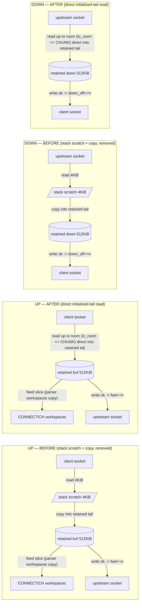

# Alumina — Reduced-Copy Single-Owner Relay Plan (Proposed)

> **STATUS: §4 direct initialized-tail reads IMPLEMENTED (alumina-vdpi.3, after
> AS-IS `8dbbec8`); §7 measurement plan NOT RUN — no measured or
> release-qualified performance claim.** The direct initialized-tail read
> described in §4 is implemented in both directions in `src/serving.rs`
> (`client_readable` up read and `relay_upstream_to_client` down read): socket
> bytes are read directly into the boot-initialized unused retained tail,
> the returned read count is committed once (`buf_len/down_len += n`), and
> parsers feed from already-retained bytes with no append copy. The
> scratch→retained placement copies listed in §2 (`"the copy this plan
> removes"`) are removed. Remaining copies are unchanged: kernel socket copies,
> the parser workspace copies §5.1 (CONNECT 8 KiB `src/connect.rs:133-139`;
> ClientHello input+flatten `src/client_hello.rs:232-243,304`), and relay-phase
> compaction. Behaviour is preserved (byte-exact relay, gates, compaction
> absolute offsets, directional FIN, full-room guards, shared fair budget
> unchanged); exact-input gate evidence is recorded under `alumina-vdpi.3`.
> The canonical specification `docs/alumina-proxy.md` (sha256 `322b68ee…5b836`)
> is byte-unchanged. Earlier plan text describing the seams at HEAD `aa92329`
> or as **PROPOSED** describes the design as authored before implementation;
> §4/§5 headers carry the implemented status.

## 1. Objective, alignment, scope

**Objective (one line).** Remove the per-direction *retained-buffer* copy in the
single-owner relay by reading socket bytes directly into the already-initialized
unused tail of the existing retained per-direction buffer — and committing only
the returned **read** count — while leaving every fixed limit, cursor, gate
accounting rule, and outcome unchanged.

**Alignment with what already exists.** Bimodality and typed teardown are
**already-realised, as-built** design, not something this plan creates. The
Stage-gated relay pipeline at HEAD `aa92329` (canonical `docs/alumina-proxy.md:34,50,147,
219,220`):

- **Typed setup (validated metadata, original bytes preserved).** CONNECT is
  incrementally parsed into `ConnectRequest{normalized FixedHostname}`
  (`src/connect.rs:121,133`); the initial ClientHello is inspected into
  `ValidatedHello` (`src/client_hello.rs:232-243`, `src/gate.rs:120`). Both run
  **only** in their pre-gate stages (`Stage::ReadingConnect` /
  `Stage::ValidatingHello`, `src/serving.rs:1335-1349,1383-1389`). Reads land in
  the retained buffer via `append_client_bytes` (`src/serving.rs:1405-1413`);
  parsers copy into their own fixed workspaces, leaving the retained stream
  untouched and forwardable (`src/connect.rs:133-139`; `src/client_hello.rs:232
  -243,304`).
- **Opaque relay (zero parser work).** `Stage::Relay` arms call only
  `append_client_bytes` + `flush_client_upstream`, and for the reverse flow raw
  `down` copy + `flush_down` (`src/serving.rs:1335-1389,1710-1744,1791-1868`).
  No parser/inspector is invoked post-gate; the proxy never decrypts payload or
  inspects TLS records (`docs/alumina-proxy.md:50,219`).
- **Typed transport teardown (no encrypted-TLS inspection).** `classify_read`
  maps `Ok(0)`→`Activity::Eof`, `ConnectionReset`→`Reset`, `WouldBlock`→`Wait`,
  `Interrupted`→`Retry`, other→`Failed` (`src/serving.rs:222-233`). First EOF
  starts a never-reset 5 s drain deadline (`:1947-1978`, `DRAIN_SECS :82`);
  `finish_drain` half-closes a direction's write side only when that direction's
  accepted bytes have fully drained (`:1985-2009`); `maybe_close_drained` closes
  exactly once at both-EOF-drained (`:2013-2046`).

The plan's scope is therefore the **narrower retained-store copy removal**,
orthogonal to the parser workspaces: it does *not* create bimodality, enable
opaque forwarding, or touch typed teardown.

**Scope (historical — the removed copies).** At plan authorship the two read
sites in `src/serving.rs` read into a stack `scratch` and then copied into the
retained buffer; §4 removes exactly those copies and both sites now read
directly into the retained tail (no scratch in the up/down payload receive
paths):

- client → upstream (`client_readable`): read at `src/serving.rs:1363-1376` →
  the `append_client_bytes` copy at `src/serving.rs:1405-1413`.
- upstream → client (`relay_upstream_to_client`): read at `src/serving.rs:1846
  -1854` → the `down` copy at `src/serving.rs:1861-1865`.

**Out of scope (unchanged behaviour / preserved exclusions).**

- Ring buffers, kernel zero-copy (`splice`/`sendfile`/`io_uring`/`MSG_ZEROCOPY`),
  multi-worker, new libraries, features, or `unsafe` uninitialized I/O.
- The parser-owned fixed-array copies that remain (see §5): direct-tail reads
  remove the scratch → retained copy **only**; the pipeline is not copy-free.
- Fixed resource profile: 128 slots × 2 × 512 KiB retained buffers = 128 MiB
  traffic storage (`src/inventory.rs:9-12`; `docs/alumina-proxy.md:183`), one shared
  complete-visit I/O budget of 64 KiB-or-16-I/O-ops across reads **and** writes,
  whichever comes first (`src/serving.rs:99-100` typed `VISIT_OPS`/`VISIT_BYTES`
  visit counters; `docs/alumina-proxy.md:146`), zero post-boot heap alloc/dealloc
  incl. dependencies (`docs/alumina-proxy.md:206`).
- Successful-write gate accounting (`committed = buf_base + fwd − head_len`,
  advance only on `Ok(n)`), coalesced tails, partial I/O, backpressure, fixed
  storage, single boot/serving owner: all preserved.
- Canonical spec, runtime code, dependencies, `docs/architecture.md` decisions,
  managed instructions and doctrine: none edited by this plan. No benchmark
  framework, numeric budget, daemon/VM/cloud effect, or runtime/E2E rerun for
  unchanged code.

No runtime/spec/dependency/managed-doctrine edits; no new enum/wrapper/injection
requirement; no force push or history rewrite.

## 2. Current state (as-built at HEAD aa92329)

Single-owner, single-threaded event loop (`src/serving.rs`; `docs/alumina-proxy.md:
140,146,147`), per-slot `SlotWorkspace` (`src/serving.rs:312-340`). Each tunnel
slot owns two boot-retained 512 KiB buffers moved in by value from the boot
store (`src/serving.rs:343-373,494-500`):

| Buffer | Direction | Capacity | Cursor model |
|---|---|---|---|
| `buf` | client → upstream | `HOLD_CAP` 512 KiB (`:69`; `inventory.rs:11`) | `buf_base`, `buf_len`, `fwd`, `parse_rel`, `insp_rel`, `head_len`, `hello_end`, `hello_consumed` (`:323-331`) |
| `down` | upstream → client | `DOWN_CAP` 512 KiB (`:73`) | `down_len`, `down_off` only — no base, no compaction (`:332-334`) |

### 2.1 Copy inventory — client → upstream (per byte, current)

1. **Read** client socket into the boot-initialized retained tail, room-limited
   (`src/serving.rs:1680-1686`: `room = io_room(index, CHUNK)`; `CHUNK = 4096`
   `:116`; typed visit budget `VISIT_OPS` / `VISIT_BYTES` `:99-100`). Nonblocking;
   `WouldBlock` returns without progress; `Ok(0)` → `Activity::Eof`.
2. ~~**Append copy**~~ **Removed by §4 (implemented):** the read targets
   `&mut buf[buf_len .. buf_len + room]` directly and commits `buf_len += n`
   once; no scratch-to-retained copy exists in the up path.
3. **Conditional compaction** `compact()`: `copy_within(fwd..buf_len, 0)` moving
   the live tail front, `buf_base` advanced in lockstep (`src/serving.rs:507
   -516`); runs only when `fwd > 0` (relay) and the tail is near cap
   (`buf_room`, `:1556-1561`).
4. **Parser/inspector internal copies (remain, out of scope):** CONNECT head
   copy (`src/connect.rs:133-139`); ClientHello input copy + flat-record copy
   (`src/client_hello.rs:232-243,304`); both fixed-array workspaces accounted in
   `SLOT_WORKSPACE_BYTES` (`src/inventory.rs:15-18`).
5. **Syscall write** upstream, `fwd += n` only on `Ok(n)` (`drain_to_upstream`
   `src/serving.rs:2045-2094`).

### 2.2 Copy inventory — upstream → client (per byte, current)

1. **Read** upstream socket into the boot-initialized retained down tail,
   room-limited (`src/serving.rs:2211-2218`: `room = io_room(index, CHUNK)`),
   blocked at `down_len + CHUNK > DOWN_CAP` (`:2208-2210`).
2. ~~**Retained copy**~~ **Removed by §4 (implemented):** the read targets
   `&mut down[down_len .. down_len + room]` directly and commits `down_len += n`
   once; no scratch-to-retained copy exists in the down path.
3. **Syscall write** client, `down_off += n` only on `Ok(n)` (`flush_down`
   `src/serving.rs:2148-2200`); full drain resets both cursors to 0
   (`:2195-2199`).

### 2.3 Gate and D3 write accounting (current)

Forwarded-byte accounting advances **only on successful writes**, cumulative and
non-decreasing (`src/gate.rs:208-240`). `committed = buf_base + fwd − head_len`
(`src/serving.rs:2110-2113`). `drain_to_upstream` may issue several successful writes
in one burst; `flush_client_upstream` then reports the cumulative projection
ONCE per burst via `gate.upstream_write(committed)` (`:2097-2146`; report at
`:2114`). D3 hence
locates the gate opening in this **worker accounting transition — before any
subsequent upstream read — not inside a single write syscall**
(`docs/architecture.md:75-79`; `docs/alumina-proxy.md:147`). `upstream_write` returns
`GateOpened { crossing, relay_from_open }` where `relay_from_open =
cumulative − hello_len` counts the **accepted** trailing bytes only
(`src/gate.rs:228-235`). No second byte count exists.

**Immediate post-opening second drain.** On `GateOpened`/`Open`, after the gate
transition sets `Stage::Relay`, `flush_client_upstream` **immediately** calls
`drain_to_upstream` a second time and, if the second burst advanced `committed`,
issues a second `gate.upstream_write(committed2)` (`src/serving.rs:2127-2140`).
A residual coalesced tail therefore persists when the second drain **either**
stalls on a non-writable upstream **or** exits on an exhausted shared
complete-visit budget (`src/serving.rs:2049-2050`), leaving the tail for a
later visit; otherwise it drains in the same call.

## 3. Concrete stream examples (source walk at aa92329, not executed)

### 3.1 Fragmented ClientHello + coalesced tail (+ immediate second drain)

CONNECT consumes `C` bytes; the valid initial ClientHello arrives as 1536 then
2560 wire bytes, coalesced with `X = 1000` trailing tunnel bytes. These are
stream offsets/read fragments, not preserved packets or TLS-record sizes.

1. Fragment 1 (1536) is incomplete → no forwarding (barrier A).
2. Fragment 2 (2560) completes validation at `hello_end = head_len +
   hello_consumed` → `H = 4096`; the 1000 coalesced bytes remain retained after
   `hello_end` (`src/serving.rs:1688-1694`).
3. **Burst 1 (WouldBlock-separated).** The upstream is not yet writable: a drain
   writes exactly 1536 accepted bytes then stalls (`WouldBlock`), so
   `drain_to_upstream` returns and `flush_client_upstream` reports the burst's
   ONE cumulative projection, 1536 — still below `H` → `WritingHello { total:
   4096 }` (`src/gate.rs:225-226`); `fwd` is set to `head_len − buf_base` on
   entry (`src/serving.rs:1693`).
4. **Burst 2 (separate, later upstream-writable edge).** A second drain writes
   a further 2964 bytes, cumulative 4500, crossing `H` by 404 → the single
   burst report is `GateOpened { crossing: 4500, relay_from_open: 404 }`
   (`src/gate.rs:228-235`). Because `gate.upstream_write` is invoked once per
   burst at the final cumulative (`:1747-1760`), a **single** burst with
   successive successful writes cannot surface an intermediate `WritingHello`
   at 1536 — that intermediate transition exists only across
   WouldBlock-separated bursts.
5. `flush_client_upstream` then immediately attempts a **second drain**
   (`src/serving.rs:1773-1785`). If it stalls, the 404 bytes already accepted by
   the crossing burst stay forwarded and residual `X = 596` remains retained-
   pending; if it does not stall, `X` drains in the same call. This plan
   retains, and the future TDD must test, the "immediate post-opening second
   drain" shape.
6. Residual `X` resumes on the upstream-writable relay arm (`src/serving.rs:1543
   -1552`) and on the client-readable relay re-flush before its next read
   (`:1356-1361`). `client_writable`'s relay arm flushes the down buffer and
   resumes upstream reads; it does **not** re-flush residual up `X`
   (`:1924-1938`).

### 3.2 FIN with reverse pending (directional drain, not TLS inspection)

Start Relay with upstream-pending bytes and downstream-pending bytes while the
downstream writes are stalled. Client FIN **arrival/readiness** merely makes the
`client_readable` arm eligible (`src/serving.rs:998-999`); pending **up** bytes
must flush first (`:1356-1360`), so an orderly EOF may not be **observed** until
those bytes drain. On a real `Ok(0)`: `classify_read` maps it to
`Activity::Eof` (`:222-233`) — a typed **TCP stream signal**, never a
close-notify or encrypted-record inspection (`docs/alumina-proxy.md:219`).

- `observe_up_eof` sets up-side EOF and starts the once-only 5 s drain deadline
  if not already running (`src/serving.rs:1947-1958`).
- `finish_drain` half-closes the **upstream** write side only when the up buffer
  has fully drained (`fwd >= buf_len`); it neither discards the reverse
  (down-pending) bytes nor closes the client socket (`:1985-1995`).
- Down writes may later finish to the client, reset down cursors, and resume
  upstream reads (`:1791-1830,1924-1935`).
- When the upstream `Ok(0)` is then observed (`observe_down_eof` `:1965-1978`)
  and the down buffer drains, the client write side is half-closed; both
  half-closed states make `maybe_close_drained` close the slot exactly once
  (`:2013-2046`). Expiry with pending bytes is failure, not normal completion
  (`docs/alumina-proxy.md:191,220`).

Distinguish TCP arrival/readiness from **observed** read EOF and from the
deadline start; `SideEof` carries the explicit state, and cursor checks
(`fwd >= buf_len`, `down_off >= down_len`) — not a new type — guarantee the
no-half-close-with-pending invariant (RF-003). Existing real-socket test
exercises client FIN then reverse drain (`src/serving.rs:3229-3339`; inspected,
not rerun here).

## 4. Direct initialized-tail read (IMPLEMENTED)

The seam is *reading directly into the initialized unused retained tail* and
committing only the returned count, dropping the stack `scratch` and its copy
into the retained buffer for both directions.

### 4.1 Up direction (client → upstream)

Replaces the pre-change read+append sites (at plan authorship `src/serving.rs:1363-1376`
read into a stack `scratch` + `:1405-1413` `append_client_bytes` copy):

1. The existing `buf_room` guard runs first (`:1319-1325,1348-1355`): it compacts
   when `fwd > 0 && HOLD_CAP − buf_len < CHUNK`, and refuses/rejects/returns when
   `buf_room < CHUNK`, so **no zero-length tail is ever handed to the nonblocking
   read** (a zero-length read returns `Ok(0)` = false `Eof`).
2. Read directly into a **room-sized** tail slice
   `&mut ws.buf[buf_len .. buf_len + room]` with `room = self.io_room(index,
   CHUNK)` (`src/serving.rs:1680-1686`): at most `CHUNK`, and shorter when the
   live visit's remaining byte room sits below `CHUNK`. The tail is non-empty at
   the call site: `visit_exhausted` returns/reschedules before the read
   (`:1646,1662`) and `buf_room` refuses/rejects/returns when `buf_room < CHUNK`
   (`:1662-1668`). The slice stays within the shared complete-visit budget
   (`VISIT_BYTES`/`io_room` `:99-100,1587-1597`; `docs/alumina-proxy.md:146`).
3. **Commit only the returned `n`** (a read count): `buf_len += n`.
   `WouldBlock` commits nothing.
4. Feed the parser/inspector from already-retained bytes
   `&ws.buf[parse_rel..buf_len]` / `&ws.buf[insp_rel..buf_len]` (the validate
   path already skips appending when `added == 0`: `buffer_and_validate` at
   `src/serving.rs:1983-1993` commits only on `added > 0` and feeds the retained
   `&ws.buf[insp_rel..buf_len]`; `enter_validating_hello` enters with zero added
   at `:2037-2038`).
5. **Borrow ordering.** The tail borrow lives only across `read`; `buf_len` is
   mutated and compaction happens after the borrow ends (compact with a live
   tail slice is an aliasing defect). The up read is a **direct field-disjoint
    borrow** `(slot.client, &mut slot.buf[buf_len..])` in one scope (mirroring
    `drain_to_upstream` `:2054-2075`), **not** a call through the whole-owner
    `read_upstream(&mut self, …)` helper (`:1972`), whose `&mut self` overlaps a
    tail borrowed from the same `SlotWorkspace`. The borrow-clean shape was
    argued by construction; compile/behavior proof is producer-owned and was
    delivered by the produced tests — never claimed as a review result.

**Removed copy:** §2.1 item 2. **Unchanged:** `fwd`/`compact()`/`buf_base`
invariant — compaction stays relay-only (pre-gate `fwd == 0` no-op,
`src/serving.rs:507-516`).

### 4.2 Down direction (upstream → client)

Replaces the pre-change read+copy site (at plan authorship `src/serving.rs:1846-1865`):

1. Keep the block-at-`down_len + CHUNK > DOWN_CAP` guard
   (`src/serving.rs:2208-2210`) — it is exactly the guarantee that the tail
   slice is non-empty; `visit_exhausted` returns/reschedules before the read
   (`:2204-2207`); backpressure/refusal policy unchanged.
2. Read upstream directly into a **room-sized** tail slice
   `&mut ws.down[down_len .. down_len + room]` with `room = self.io_room(index,
   CHUNK)` (`src/serving.rs:2211-2218`): at most `CHUNK`, shorter when the live
   visit's remaining byte room sits below `CHUNK`; non-empty at the call site
   by the same visit/guard reasoning as §4.1.
3. Commit only the returned `n`: `down_len += n` (`:2237-2240`); `WouldBlock`
   returns without mutation (`:2226-2229`).
4. `flush_down` (`:2148-2200`) and the full-drain reset (`:2195-2199`) are
   untouched; `down_off` advances only on successful client writes, refusal
   bodies flow through the same `down` store.

**Removed copy:** §2.2 item 2. **Unchanged:** the down cursor model, drain reset,
and FIN half-close (`finish_drain` `:2364-2388`, `maybe_close_drained`
`:2392-2401`).

### 4.3 Test seams (simplified; no forced helper)

`read_upstream(&mut self, index, buf)` (`src/serving.rs:1972`) borrows the whole
owner and cannot receive a mutable tail from `self.slots[index]`; the relay
payload read has always bypassed that helper. Two facts:

- The relay payload read (down) is the **direct field-disjoint read**
  `(slot.upstream, &mut slot.down[down_len..])` (`src/serving.rs:2211-2218`) —
  the same disjoint-field rule the file already relies on. That shape is
  implemented; compile proof was producer work and is delivered by the produced
  tests.
- The **pre-open activity read** (`observe_upstream_read` `:1930`) keeps a
  stack `scratch` and its `test_reads` hook (`:466,499,1974`) stores only
  `io::Result<usize>` counts — payload is irrelevant because any observed
  activity terminates setup. That count-only semantics is preserved.

Real sockets are already the deterministic route the current relay tests use
(e.g. `relay_client_fin_drains_pending_bytes_then_half_closes_and_releases`
`src/serving.rs:3229`). An injected `Ok(n)` alone does not place bytes, so no
separate injection API is **mandatory** for the payload read; whether the TDD
cycle drives real sockets or adds a seam is a test-story decision consistent
with this plan's unchanged scope. The previous version overstated this need as a
required helper; this plan presents it as optional.

## 5. Diagrams (IMPLEMENTED)

### 5.1 Data path before/after, both directions



```text
BEFORE   client -> upstream : read->scratch  copy(scratch->buf)  feed(parse)  write(fwd)
AFTER    client -> upstream : read -> buf tail (direct, room<=CHUNK)  feed(parse)  write(fwd)
                              (scratch + scratch->buf copy removed)

BEFORE   upstream -> client : read->scratch  copy(scratch->down)  write(down_off)
AFTER    upstream -> client : read -> down tail (direct, room<=CHUNK)  write(down_off)
                              (scratch + scratch->down copy removed)

Workspace copies that REMAIN (not copy-free):
  CONNECT head copy (src/connect.rs:133-139)
  ClientHello input copy + flat-record copy (src/client_hello.rs:232-243,304)
  compaction copy_within (src/serving.rs:507-516)   [relay phase only]
```

### 5.2 Cursor/held picture per direction (implemented)

```text
UP    held       absolute [buf_base .. buf_base + buf_len)
      forwarded  absolute [buf_base .. buf_base + fwd)     (fwd = in-buffer offset)
      gate committed abs = buf_base + fwd - head_len
      DIRECT tail read (implemented): &buf[buf_len .. buf_len+room], room = io_room(index, CHUNK) (<= CHUNK, nonzero), then buf_len += n

  buf_base            buf_base+fwd         buf_base+buf_len
  |-------------------|---------------------|----------------------|
  | forwarded         | pending (accepted,  | empty tail (init,     |
  | (write-ok)        | forwardable)        | reusable)            |
  | abs base..+fwd    | in-buffer fwd..len  | DIRECT tail read      |
  |                   |<- write ok advances fwd ->|    (room<=CHUNK) |
  |                   |<- compact() moves (fwd..buf_len)->0, buf_base+=fwd -- relay only

DOWN  held [.. down_len)   written [.. down_off)
      DIRECT tail read (implemented): &down[down_len .. down_len+room], room = io_room(index, CHUNK) (<= CHUNK, nonzero), then down_len += n
  |--------|----------------------------------|---------------------|
  | written| pending                          | empty tail (init,   |
  down_off|                                  down_len     reusable) |
```

## 6. What stays fixed (limits, invariants, accounting)

| Element | Value / rule | Source |
|---|---|---|
| Retained per-slot store | 2 × 512 KiB (`buf`+`down`), 128 slots, 128 MiB | `inventory.rs:9-12`; `docs/alumina-proxy.md:161-164,183` |
| Boot ownership | single boot owner, buffers moved in by value, no post-boot heap alloc/dealloc | `serving.rs:640-648` (`Serving::preallocate` seam), `470-500` (`with_traffic` move-by-value `buf: up` at :483 / `down` at :492); `docs/alumina-proxy.md:150,206` |
| Complete-visit I/O budget | one shared 64 KiB-or-16-ops read+write budget per connection visit, whichever first; direct tail reads/writes are clamped to the remaining room via `io_room` | `serving.rs:99-100` (`VISIT_OPS`/`VISIT_BYTES`), `1565-1597` (`visit_exhausted`/`note_op`/`io_room`), `2045-2094` (`drain_to_upstream`), `2148-2200` (`flush_down`); `docs/alumina-proxy.md:146` |
| Setup caps | CONNECT 8 KiB; ClientHello ≤ 64 KiB, record payload 16 KiB; serving buffers are the coarser backstop | `connect.rs:8,131-152`; `client_hello.rs:6-9,238-249`; `docs/alumina-proxy.md:163-164` |
| Gate accounting | `committed = buf_base + fwd − head_len`; advance only on successful writes; **no second byte count** | `serving.rs:2110-2113`; `gate.rs:208-240`; `docs/alumina-proxy.md:147,220` |
| Gate open | one `gate.upstream_write` per burst + immediate second drain on open; opens before subsequent upstream read; coalesced `X` retained, never duplicated | `gate.rs:213-240`; `serving.rs:2097-2146`; D3 |
| Barriers | no client bytes before full validation; no upstream bytes before gate open; pre-open upstream activity terminates | `gate.rs:245-252`; `docs/alumina-proxy.md:201` |
| Down reset/backpressure | full-drain reset; full tail → no read, stall/re-arm; fixed 200/refusal bodies | `serving.rs:2195-2199,2208-2210`; `docs/alumina-proxy.md:185` |
| Drain/closure | first EOF starts never-reset 5 s drain; directional half-close only when drained; both-EOF+drained closes exactly once | `serving.rs:82,2326,2364-2401`; `docs/alumina-proxy.md:190-191` |
| Parser workspace copies | CONNECT 8 KiB + ClientHello 64 KiB input/flatten copies **remain** (not copy-free) | §5.1; `serving.rs:1754,1983`; `docs/alumina-proxy.md:206` |
| Compaction | `compact()` relay-only (pre-gate `fwd == 0`), `buf_base` lockstep, cumulative invariant preserved | `serving.rs:507-516`; D5 |

## 7. Ranked seam assessment, workload model, measurement plan

This section was written as pre-implementation assessment; it is now
**historical design context**, not a decision record. The §4 direct-tail seam
**was implemented** under explicit user authorization (`alumina-vdpi`: "User
authorizes TO-BE implementation"; executed as `alumina-vdpi.3` on HEAD
`8dbbec8`, preserved in the current `src/serving.rs` candidate). Measurement
remains NOT RUN (§7.3); at authorship and now, **no measured-benefit claim is
made** (`docs/alumina-proxy.md:185,236` throughput targets are unverified). The
ranked seams below are retained as assessment only.

### 7.1 Ranked optimization seams (assessment)

| Rank | Seam | Conditional value / tradeoff | Gate to promotion |
|---|---|---|---|
| 1 | Minimal direct initialized-tail read in both retained stores (§4). | Removes the scratch→retained copy and keeps types/cursors/gate/storage. Does **not** remove kernel copies, parser workspace copies, or guarantee fewer syscalls. | room/backpressure policy, non-empty `CHUNK` slice, single receive commit, field-disjoint borrow, and native behaviour evidence. |
| 2 | Preserve existing conditional up-compaction + bounded read-loop batching. | Already present; not a new gain. No down compaction: full drain resets down cursors. Avoid eager memmove or intentional buffering delays. | `src/serving.rs:1319-1324,379-388,1330,1826-1829`. |
| 3 | Changed syscall policy / coalescing. | Potentially relevant for small records and bulk, but delays/fairness/backpressure/D3 accounting become behavioural questions; larger reads are not implied by copy removal. | Measured calls/bytes + latency, preserving canonical per-connection visit limits. |
| 4 | Physical hot/cold layout separation. | Stage already avoids cold parser work; inline large workspaces establish stride plausibility, not cache misses. Refactor complexity precedes unmeasured gain. | Target build offsets/access/cache attribution; no assumed field order. |

Kernel zero-copy stays deferred (user decision `alumina-3xjr.4`).

### 7.2 Conditional workload cost model (illustrative, not measured)

Let `B` = successful source-read tunnel bytes (post-hello each direction). The
seam removes one scratch→retained copy per admitted read; **saved copy volume is
logical memcpy bytes**, not doubled hardware memory traffic, CPU dominance, or
measured end-to-end benefit. No coefficient is claimed.

| Workload (illustrative) | Saved-copy model | Competing explanation / expectation |
|---|---|---|
| Setup-heavy short tunnels: `C=512 B`, `H=4096 B`, 1 KiB opaque each way. | ~6.6 KiB/tunnel removed at receive seam. | Parsing, dial, readiness, resets, workspace init may dominate; latency has non-copy contributors. |
| Long bulk: 4 MiB each direction after setup. | 8 MiB relay copying removed; ≥2048 successful 4 KiB reads minimum. | H1 (CPU/copy-limited) strongest, but H2/H3 remain viable; `POS-LARGE-ECHO` is functional, not performance evidence. |
| Small bidirectional: 1000 × 128 B exchanges. | 256 KB removed; ~2000 data reads+writes plus readiness probes if unaggregated. | Fixed syscall/event costs can dominate per-byte copy; TCP records do not set read boundaries. |
| Stalled consumers: sink stops, pending retained bytes. | Savings only for bytes admitted before pause. | Read paths stop on pending writes (`:1356-1360,1397-1400,1866-1868`); fixed memory + deadline/backpressure dominate. |

### 7.3 Comparable future measurement plan (PLANNED — NOT RUN)

Use current native functional scenarios with deliberately matched workloads, not
a new benchmark framework. Baseline and tail-only candidate share exact build
identity (commit/dirty diff, lockfile/toolchain/features/optimization target,
production Linux CPU/container/kernel/mio context, machine date/load/
concurrency/affinity, cache state); hold endpoints/payloads/fragmentation/
coalescence/arrival/concurrency/sink/DNS/logging equal. Record CPU
time/utilization, wall-elapsed, latency, successfully forwarded bytes once,
successful/failed read/write calls and bytes/call, logically removed copy
volume, observed compaction, queue/pending, deadline/DNS progress, run
variation. Exclude boot/fixture/endpoint CPU and unrelated network waits from
proxy-only CPU. No native CPU/copy/stack-instrumentation command exists — that
is the named unresolved seam from the prior oracle; do not describe planned
metrics as available receipts. Being a document review, unchanged code needs no
runtime rerun here.

### 7.4 Performance attribution falsifiers (conditional, not executed)

| Hypothesis | Concrete falsifier (decided by §7.3 measurement, never inferred) |
|---|---|
| H1 — copy removal yields material CPU benefit on a long CPU-limited stream. | Same-input before/after CPU per successfully forwarded byte stays within run variation despite removing that copy; OR an existing profile shows negligible time at the copy sites (`src/serving.rs:1363-1380,1405-1413,1846-1865`). |
| H2 — fixed setup/reset and syscall/readiness costs dominate, so copy removal has little end-to-end benefit. | Same-target profile instead shows retained-copy cost dominating, or tail-only change materially improves comparable CPU/latency with unchanged syscall counts. |
| H3 — slow sinks/network limits dominate throughput; copy removal cannot raise completion rate. | A matched slow-sink run improves throughput under an identical sink rate, or profiling shows CPU rather than sink saturation. |
| H4 — cold parser metadata warrants physical layout separation. | No cold-cache/stride contribution in the target profile, or measured field offsets/access footprint show adequate locality. |

H1/H2 compete on CPU attribution, H3 on throughput attribution, H4 on layout;
none is a measured performance verdict (`docs/alumina-proxy.md:185,236` targets unverified).

### 7.5 Complete-visit budget — superseded by AS-IS work (historically an open gap)

At plan authorship, `docs/alumina-proxy.md:146` bounded **total per-connection
I/O** but the read loops' `MAX_OPS` counters could not prove a combined
read+write visit budget. **That gap was closed by the AS-IS fairness work
(alumina-vdpi Phase A, published at `8dbbec8`), which introduced a
complete-visit budget shared across reads and writes:** typed `VISIT_OPS = 16`
/ `VISIT_BYTES = 64 KiB` visit counters owned by dispatch
(`src/serving.rs:99-100`); every read/write attempt is recorded via `note_op`
(`:1565-1582`); the read arms (`client_readable` `:1644`,
`relay_upstream_to_client` `:2202`) and the write drains
(`drain_to_upstream` `:2045-2094`, `flush_down` `:2148-2200`) all check
`visit_exhausted`/`io_room` and count attempted syscalls incl. `WouldBlock`; and
deadline/DNS/timer turns rejoin at most every 256 ready-slot visits or I/O ops
(`:1604-1618`; `docs/alumina-proxy.md:146,213`). The earlier "reads alone are
budgeted, write drains lack counters" wording is **superseded** and does not
describe HEAD `8dbbec8` or this candidate. Remaining qualification gates are
distinct and still open: serving-phase allocation-freedom (hence no
"zero-alloc proven" claim), the later-slice/release gates, and any native
release acceptance — none is claimed by the direct-tail change.

## 8. Material risks and cheap falsifiers

| Risk | Cheap falsifier (read-level / design check) |
|---|---|
| Borrow alias / stale cursor | tail length derived from the same `buf_len`/guard the code mutates; only disjoint fields borrowed, borrow spans only `read`. |
| Parser retained slice vs compaction resetting `H` | compaction is pre-relay no-op (`fwd == 0`); `parse_rel`/`insp_rel` reset only on slot reset (`:399-400`); no compact between a tail read and its feed. |
| Gate bug / wrong committed projection | `committed = buf_base + fwd − head_len` unchanged; **no second byte count**; gate unit tests stay green. |
| Zero-length tail → false `Ok(0)` EOF | keep `buf_room` guard + `< CHUNK` refusal; tail slice never empty at the read site. |
| Per-visit bound drift | clamp direct read to `CHUNK`; no larger-read/syscall change implied. |
| `WouldBlock`/failure offsets | no offset advances on failure; `fwd`/`down_off` mutate only on `Ok(n)` (existing). |

This table falsifies **implementation correctness** only; the performance
attribution falsifiers (H1–H4) are stated separately in §7.4. None executed
here; they are the falsifiers for the independent review and the
future TDD cycle.

## 9. Discussion points (historical — resolved or superseded by implementation)

1. **Test seam for the payload reads (RESOLVED).** Real sockets are already the
   route the relay tests use; real client sockets are a valid deterministic
   route for the up read. An injected count alone does not materialize bytes,
   so a separate injection API is **optional**, not mandated (§4.3). The
   implementation used the real-socket route (new tests
   `direct_tail_up_read_commits_read_count_once_at_tail_offset` /
   `_down_..._at_tail_offset`, `src/serving.rs`): both start `buf_len`/`down_len`
   at 0, so they characterise the returned read count committed once and payload
   byte-exactness at **zero** retained-tail offset (the read tail coincides with
   the buffer head; the untouched sentinel byte after the committed count pins
   commit-once). They do not pin a read at a **nonzero** retained-tail offset —
   that remains an open coverage limitation (relay/compaction offset behaviour
   is covered by the existing suite). The pre-open activity path keeps its
   count-only `test_reads` semantics.
2. **Implement now vs measure first (SUPERSEDED).** Authored as measure-first
   advice: the comparable before/after measurement (§7.3) "*should* precede
   committing to the borrow-risk surface". The user **explicitly authorized
   implementation ahead of measurement** (`alumina-vdpi`), so the
   recommendation does not guide the decision already made; it remains relevant
   only to whether the implemented change is *kept* after a future trustworthy
   A/B. If a measured CPU delta is negligible, the change can still be reverted
   with evidence retained.

## 10. Deliverables, review gate, tracking, rollback

**Historical note (prior session).** The bullets below as originally written
described a documentation-only session at clean HEAD `aa92329` under the prior
`alumina-bimodal-review` mission (it refined the tracked plan and the ignored
local visual `.ooda/show-me-reduced-copy-relay.html`, and recorded evidence
under `mission:alumina-bimodal-review`). That session's **decision and
publication instructions are superseded** by the implemented status and by the
current publication-preparation scope; current status is authoritative:

- **Implementing session.** The §4 direct-tail change was implemented in
  `src/serving.rs` as `alumina-vdpi.3` on HEAD `8dbbec8` (self-contained
  candidate; Rust approval `alumina-ip9c`; runtime gates `alumina-x36s`; AS-IS
  baseline `alumina-hkp6`). **This publication-preparation scope** (per
  `alumina-d5hx`) resolves the B1/B2/B3 documentation contradictions in this
  plan and in `docs/benchmarks/feature-match-matrix.md`; no runtime/spec/
  dependency edits, no measured performance or release-qualified claim.
  Canonical `docs/alumina-proxy.md` (sha256 `322b68ee…5b836`) is byte-unchanged;
  user untracked drafts (`.DS_Store`, `scripts/bench_frame_echo.py/.new/.sh`)
  are preserved untouched.
- **Review gate.** Review-ready is returned to the commander for a
  caller-owned **generic review** **before** any staging/commit/push. After
  approval, only an ordinary inspected linear `main` commit/push carrying the
  approved `src/serving.rs` plus exactly these two docs is authorized (no force
  push, no amend of a pushed commit, no reset/stash/clean of shared main, no
  forbidden hooks — effective hooks are absent); full staged content, hooks,
  remote and all outgoing commits are inspected first.
- **Rollback.** Remove only Phase-B-owned hunks before publication if needed;
  after publication, ordinary reviewed revert only. Preserve unrelated work.
- **Beads / evidence.** Raw gate exits, candidate identity, native evidence
  correspondence and this doc-correction pass are recorded in the durable
  evidence bead under `mission:alumina-vdpi`; the review-request routes through
  the commander (generic review) before publication.

## 11. References

- `docs/alumina-proxy.md` (canonical, sha256 `322b68ee…5b836`): scheduling/I-O model
  (`:146-147`), runtime prerequisites (`:150`), fixed limits (`:154,160-164`),
  traffic storage/reuse/backpressure (`:183,185`), lifecycle (`:190-191`),
  invariants (`:198,201,206,213,220`), verification (`:223`).
- `docs/architecture.md`: D2 two barriers, D3 gate opening, D4 early activity,
  D5/D5a/D5b accounting and buffer reuse, §4 state machine, §6 fixed storage.
- Source seams cited in §2–§6 (all read at HEAD `aa92329`).
- Advisory beads: `alumina-bjbo` (oracle-summary), `alumina-d5s0` (orientation);
  prior oracle summaries `alumina-ynwp`, `alumina-bqtc`, ranked orientation
  `alumina-cub9`; user decision `alumina-3xjr.4` (direction A endorsed; kernel
  zero-copy deferred).
